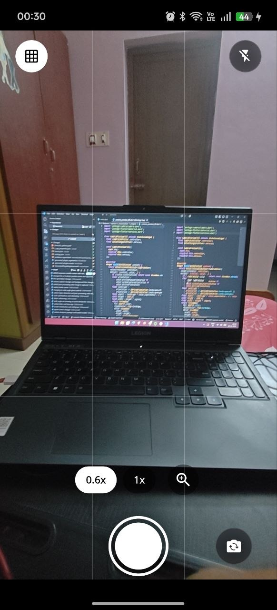
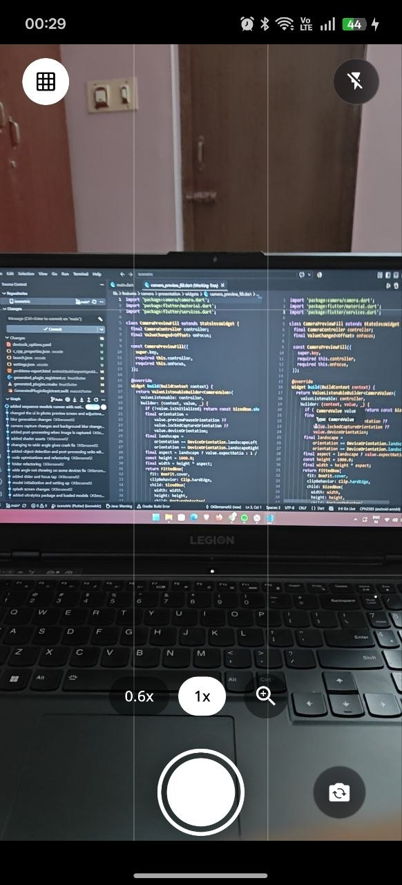
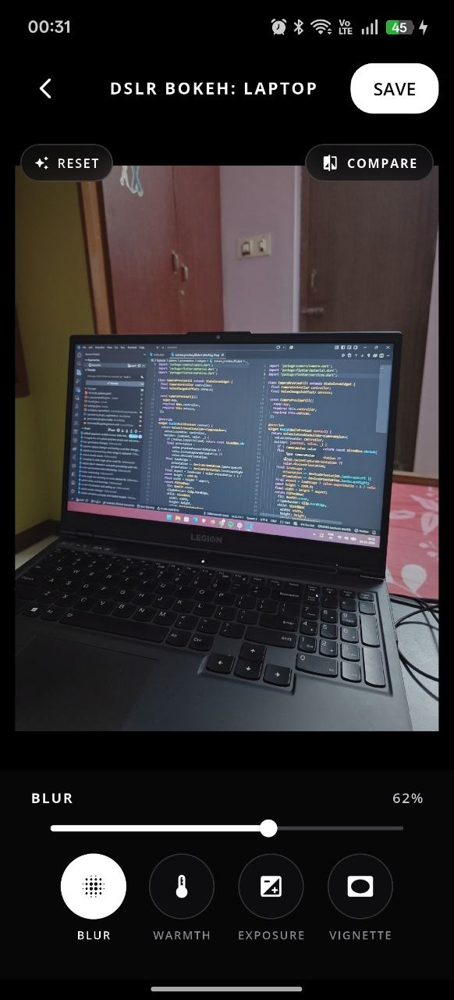

# <div style="display: flex; align-items: center; gap: 12px;"><strong>Isometric Camera</strong></div>

Isometric is a Flutter camera that gives your photos a DSLR-style look with one tap. Press the shutter and the app automatically analyzes the scene, then opens an enhanced preview with subject-aware depth of field, color grading, and detail adjustments. You can fine-tune the result in the built-in editor.

## Screenshots

| Wide camera · 0.6× | Standard camera · 1× | Photo editor |
| :---: | :---: | :---: |
|  |  |  |

## Features

- Tall viewfinder with a rule-of-thirds grid, tap-to-focus, flash controls, and front/rear camera switching.
- Wide and standard lens controls on supported devices, plus a zoom slider.
- One-tap photo enhancement with automatic scene-based grading, subject sharpening, and depth-aware background blur. If depth estimation is unavailable, the editor uses mask-based blur.
- Manual blur, warmth, exposure, and vignette adjustments. Hold **Compare** to see the original, or tap **Reset** to restore the automatic settings.

## Run on Android

Use a Flutter SDK that includes Dart 3.11.5 or later within the 3.x series, an Android toolchain, and an Android phone with USB debugging enabled. Run these commands from the project root:

```sh
flutter doctor
flutter pub get
flutter devices
flutter run
```

Select the Android device if Flutter prompts you, and grant camera permission when the app opens. The TFLite model files are bundled in [`assets/models/`](assets/models/).

## How it works

1. [`CameraSession`](lib/features/camera/domain/camera_session.dart) handles camera permissions, lens controls, and capture.
2. [`AnalysisPipeline`](lib/features/camera/domain/analysis_pipeline.dart) selects a subject from the instance segmentation results. When it finds a subject, it runs depth estimation on the same photo and combines the depth map with the subject mask.
3. On Android, [`PhotoInferenceWorker`](android/app/src/main/kotlin/com/example/isometric/PhotoInferenceWorker.kt) initializes and runs the models on a dedicated native thread. A Dart isolate decodes the inference results, and isolate tasks refine the mask and depth data.
4. [`PhotoEditorSession`](lib/features/camera/domain/photo_editor_session.dart) manages the adjustments and render queue. The [fragment shader](shaders/dslr_compose.frag) applies blur and grading to the preview.

| Bundled model | Role |
| --- | --- |
| `yolo26n-seg.tflite` | Finds the subject and produces its mask. |
| `yolo26n-depth.tflite` | Estimates depth for the blur falloff. |
| `yolo26n-sem.tflite` | Semantic segmentation model available for future use. |
| `yolo26n.tflite` | Standalone object detector available for future use. |

## Current status

The editor previews the enhanced image. **Save** currently shows a confirmation, and exporting the edited image to a file or the gallery is still pending.
